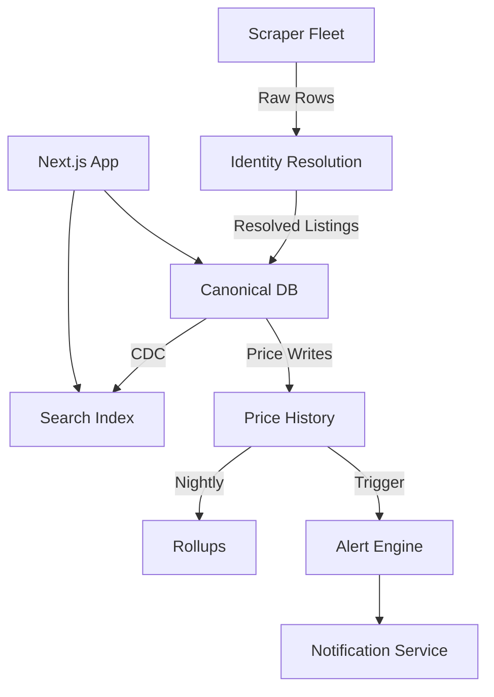

# Veridian Production Architecture

## 1. Overview
Veridian evolves from a static laptop catalog (Part A) into a dynamic, community-driven decision platform (Part B). The architecture shifts from a monolithic Next.js app to a microservice-oriented system capable of handling automated ingestion, identity resolution, price tracking, and real-time search at scale.

## 2. Core Architectural Pillars

### 2.1 Ingestion & Scraper Fleet
- **Scraper Workers**: Containerized Playwright/Node.js workers orchestrated via Redis/BullMQ.
- **Adapter Pattern**: One adapter per seller (Amazon, Best Buy, Newegg, etc.).
- **Prefer APIs**: Official retailer APIs (Amazon PA-API) are used whenever available to minimize legal risk and improve reliability.
- **Provenance**: Every scrape records source, timestamp, and collector version.

### 2.2 Identity Resolution & Normalization
- **The "Fuzzy Match" Problem**: Retailer strings (`"UX3407QA-QD123WS"`) must map to canonical SKUs.
- **Pipeline**: 
  1. Normalize (lowercase, strip noise).
  2. Extract tokens.
  3. `pg_trgm` similarity matching against `skus.sku_code` and `models.name`.
  4. Confidence Thresholds: Auto-match (≥0.6), Review (0.3–0.6), Unmatch (<0.3).
- **Caching**: Confirmed matches are cached to bypass re-computation.

### 2.3 Data Storage (Polyglot Persistence)
- **PostgreSQL (Neon)**: Source of truth for canonical products, SKUs, users, and alerts.
- **Meilisearch/Typesense**: Search index for instant faceted filtering and NL search. Synced from Postgres via CDC (Change Data Capture) or dual-write.
- **Redis (Upstash)**: Job queue (BullMQ) for scrapers and rate limiting.

### 2.4 Price Intelligence
- **Append-Only History**: `price_history` rows are never updated.
- **Nightly Rollups**: A background job computes 30/90-day averages and lowest-ever prices into `price_rollups`.
- **Alert Engine**: Listens to new price rows and triggers notifications via Resend (Email) / Telegram / Discord.

### 2.5 AI & Search Layer
- **Natural Language Search**: User queries are parsed by an LLM into the existing `/api/skus` JSON schema. Results remain exact and debuggable.
- **Recommendation Engine**: Hard-constraint pre-filtering (Postgres) → LLM ranking (OpenAI/Claude) with pros/cons.

### 2.6 Community & Trust
- **Contribution Workflow**: Proposed edits + evidence (screenshots/links).
- **Voting**: Users confirm/dispute edits.
- **Reputation**: High-reputation users gain auto-apply privileges.

## 3. Data Flow

## 4. Tech Stack

| Layer | Component | Technology |
|---|---|---|
| **Frontend** | Web UI | Next.js 14 (App Router), Tailwind CSS |
| **API** | Backend | Next.js API Routes, tRPC (for internal) |
| **Auth** | Identity | Auth.js (NextAuth) |
| **Database** | Primary | PostgreSQL 16 (Neon) |
| **Search** | Indexing | Meilisearch |
| **Queue** | Jobs | BullMQ + Redis |
| **Scraper** | Ingestion | Playwright (Dockerized) |
| **AI** | LLM | OpenAI / Anthropic / Mistral |
| **Notifications** | Alerts | Resend, Telegram Bot, Discord Webhooks |

## 5. Deployment & Infrastructure
- **Hosting**: Vercel (App), Railway/Fly.io (Workers), Neon (DB), Upstash (Redis).
- **CI/CD**: GitHub Actions for tests and Docker builds.
- **Monitoring**: Sentry for errors, PostHog for analytics.
